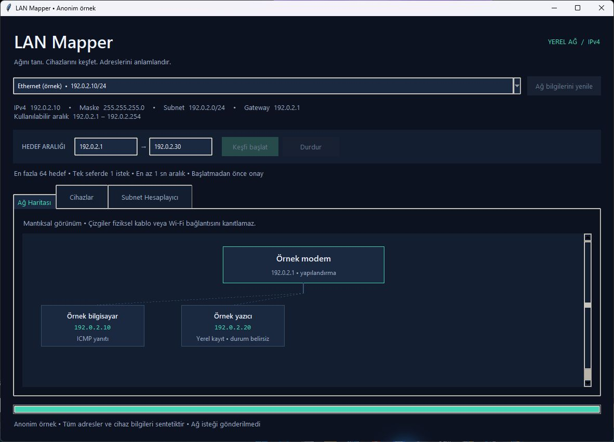
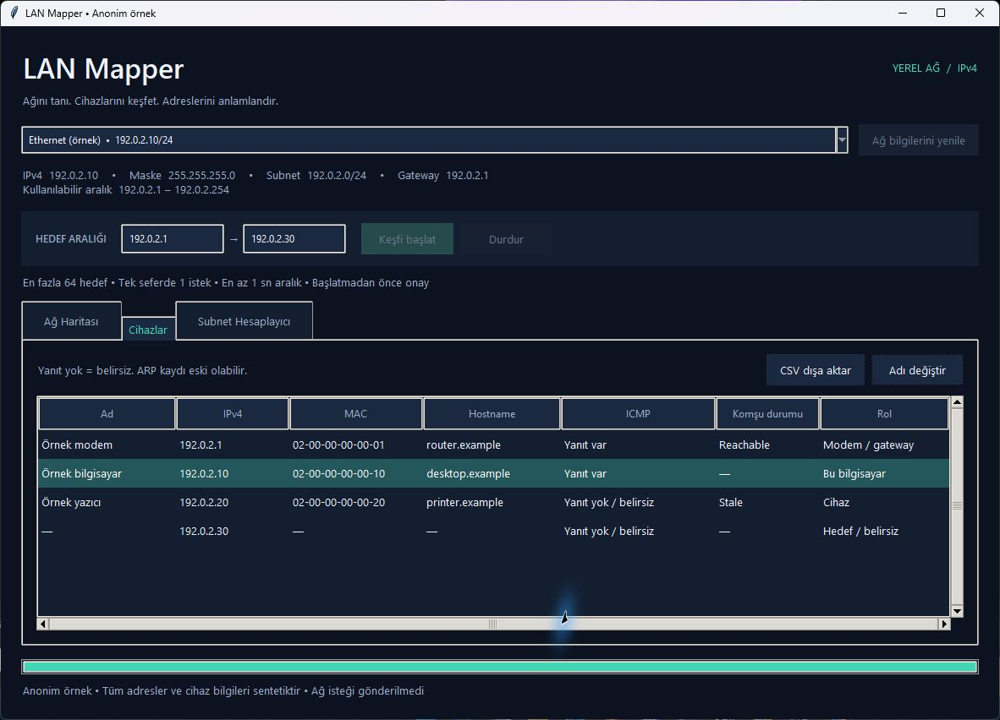
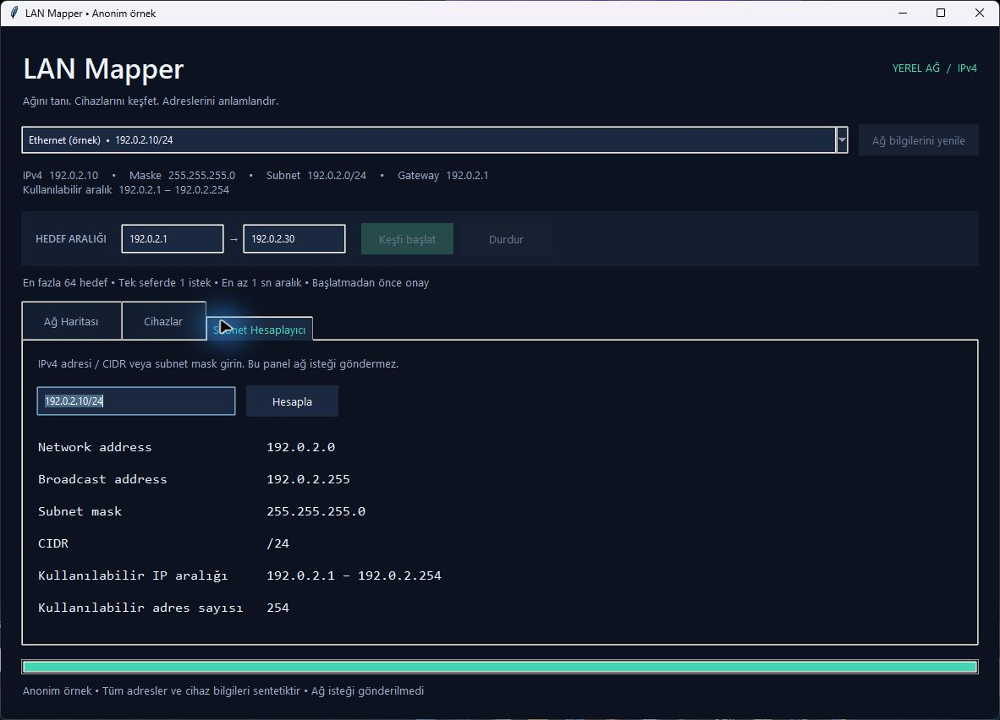

# LAN Mapper

Windows için Python ve Tkinter ile geliştirilmiş, koyu temalı basit yerel IPv4 ağ aracı. Harici Python paketi, yönetici yetkisi veya internet bağlantısı gerektirmez.

## Amaç ve özellikler

Kendi ev ağınızın adres yapısını anlamak ve yerel cihaz envanteri oluşturmak için tasarlanmıştır.

- Etkin fiziksel Ethernet/Wi-Fi arayüzü, IPv4, subnet mask, CIDR ve gateway tespiti.
- Kullanıcı onayıyla, yerel subnet içinde düşük hızlı ICMP ve Windows ARP/komşu tablosu ile keşif.
- IP, MAC, bulunabilen hostname ve belirsizliği koruyan ICMP durumu.
- Mantıksal ağ haritası, yerel cihaz adlandırma ve UTF-8 CSV dışa aktarma.
- Network/broadcast adresi, maske ve kullanılabilir adres aralığını hesaplayan subnet paneli.

## Teknolojiler

Python 3.11+, Tkinter/ttk, Windows PowerShell 5.1, Python standart kütüphanesinden `ipaddress`, `subprocess`, `threading`, `csv` ve `json`. Arayüz koyu tema kullanır; ağ işlemleri arka plan iş parçacığında çalışır.

## Çalıştırma

Windows 10/11, Windows PowerShell 5.1 ve Tkinter içeren Python 3.11+ gerekir. Python kurulumunda **Tcl/Tk and IDLE** bileşenini etkinleştirin.

PowerShell'de:

```powershell
git clone https://github.com/lyser1an/lan-mapper.git
cd lan-mapper
python app.py
```

Git kullanmıyorsanız GitHub'da **Code → Download ZIP** ile indirip arşivi açın; PowerShell'i proje klasöründe açarak `python app.py` çalıştırın. `pip install` adımı yoktur.

Alternatif: `./run.ps1`. PowerShell script politikası engellerse doğrudan `python app.py` kullanın; sistem politikasını değiştirmeniz gerekmez.

## Uygulama ekran görüntüleri

Görseller gerçek Tkinter uygulamasından, **tamamen sentetik örnek verilerle** alınmıştır. IP adresleri dokümantasyon için ayrılmış `192.0.2.0/24` bloğundadır; MAC adresleri ve `.example` hostname'leri kurgusaldır. Gerçek IP, MAC, hostname, SSID veya kişisel cihaz adı içermezler. Bu örnek bloğa keşif yapılmamıştır; uygulamanın normal keşfi yalnızca özel yerel IPv4 subnet'lerine izin verir.

### Ağ Haritası



### Cihazlar



### Subnet Hesaplayıcı



## Kullanım

1. Açılışta yalnızca ağ yapılandırması okunur. Etkin fiziksel Ethernet/Wi-Fi arayüzleri arasından varsayılan gateway ve rota metriği dikkate alınarak ilk bağlantı seçilir. Gerekirse listeden diğerini seçin.
2. Yerel IPv4, maske, CIDR, kullanılabilir IP aralığı ve gateway üst panelde görünür.
3. Hedef aralığını kontrol edin. /24 ve daha küçük ağlarda ilk en fazla **64 adres** önerilir; bu tüm subnet'in tarandığı anlamına gelmez. /23 ve daha geniş ağlarda aralık **boş bırakılır**. En fazla 64 yerel hedefi kendiniz belirtin.
4. **Keşfi başlat** düğmesine basın. Gösterilen arayüz, subnet ve aralığı doğrulayıp yalnızca kendi ağınız için onay verin. İptal ederseniz ICMP gönderilmez. Her keşif yeniden onay ister.
5. **Durdur** yeni hedefleri keser; devam eden PowerShell kontrolü bitince kısmi sonuçlar gösterilir. Normalde birkaç saniye, PowerShell zaman aşımında en fazla yaklaşık 25 saniye sürebilir. Pencere keşif sırasında kullanılabilir.
6. **Ağ Haritası**, ICMP yanıtı veya MAC bilgisi bulunan hedefleri gateway çevresinde mantıksal olarak gösterir. Gateway yapılandırmadan çizilir; çizilmesi erişilebilirliğini kanıtlamaz. Fiziksel switch, kablo veya Wi-Fi ilişkisi çıkarılmaz.
7. **Cihazlar** tüm kontrol edilen hedefleri gösterir. Cihaz seçip **Adı değiştir** düğmesini veya çift tıklamayı kullanın. Boş ad önceki adı kaldırır. MAC varsa ad MAC'e bağlanır; yoksa subnet/IP kullanılır. DHCP ve MAC rastgeleleştirmesi nedeniyle kimlik eşleşmesi kesin değildir.
8. **CSV dışa aktar** ile UTF-8 BOM içeren Excel uyumlu envanter kaydedin. Tüm kontrol edilen hedefler ve belirsiz durumları da dışa aktarılır.
9. **Subnet Hesaplayıcı** ağ istekleri göndermeden IPv4/CIDR veya IPv4/subnet mask girişini hesaplar. /31 için iki adres, /32 için tek adres gösterilir; broadcast alanı matematiksel son adrestir, /31 ve /32'de klasik broadcast kullanımı yoktur.

## Keşif sınırları ve durumların anlamı

- Yalnızca etkin fiziksel Ethernet/Wi-Fi arayüzünün RFC1918 özel IPv4 subnet'i kabul edilir: `10/8`, `172.16/12`, `192.168/16`. VPN/sanal arayüzler, IPv6, APIPA ve genel IP arayüzleri kullanılmaz. Hedef aralığına network/broadcast adresleri dahil edilmez (/31 ve /32 hariç).
- **En fazla 64 hedef**, eşzamanlı tek kontrol, ICMP başlangıçları arasında **en az 1 saniye**, hedef başına tek ICMP isteği ve **700 ms** yanıt zaman aşımı. PowerShell açılışları nedeniyle gerçek hız daha düşüktür. Arka planda periyodik keşif yoktur.
- Keşiften hemen önce arayüz tekrar okunur. Her ICMP öncesinde `Find-NetRoute` ile hedef rotasının seçili arayüzde ve doğrudan bağlı olduğu doğrulanır; VPN veya başka gateway üzerinden yönlendirme görülürse işlem durur. Ağ yapılandırmasının kontrol ile gönderim arasındaki anda değişmemesi gerekir.
- Windows `Get-NetNeighbor` (ARP/komşu tablosu) yalnızca seçili arayüz için okunur; sadece kontrol edilmiş hedeflerle birleştirilir. Eksik/sıfır/broadcast MAC kayıtları atılır. Komşu durumu Windows'un özgün `Reachable`, `Stale` vb. değeridir; eski kayıt canlılık kanıtı değildir.
- **Yanıt var:** bu kontrolde ICMP yanıtı alındı. **Yanıt yok / belirsiz:** güvenlik duvarı, uyku, istemci izolasyonu veya başka neden olabilir; kesin çevrimdışı sayılmaz. Kanıt olmayan hedefler haritaya cihaz olarak eklenmez.
- Hostname yalnızca Windows'un mevcut DNS A kaydı önbelleğinde varsa gösterilir. Ek DNS/NetBIOS sorgusu gönderilmez; boş hostname normaldir.
- Port taraması, modem ayarı değişikliği, paket dinleme, saldırı ve güvenlik duvarı değişikliği yoktur. Keşif ağın bütün cihazlarını bulmayı garanti etmez.

PowerShell işlemleri Microsoft'un [Get-NetAdapter](https://learn.microsoft.com/en-us/powershell/module/netadapter/get-netadapter), [Get-NetNeighbor](https://learn.microsoft.com/en-us/powershell/module/nettcpip/get-netneighbor) ve [Find-NetRoute](https://learn.microsoft.com/en-us/powershell/module/nettcpip/find-netroute) komutlarını kullanır.

## Yerel veriler

Özel cihaz adları `data/device-names.json` içinde tutulur. Keşif sonuçları otomatik diske yazılmaz. CSV için varsayılan klasör `exports/` olur. `.gitignore`, `data/`, `exports/`, CSV ve log dosyalarını dışlar. Bu koruma başka klasöre kopyaladığınız dosyalara uygulanmaz; IP/MAC bilgilerini veya gerçek ağ ekran görüntülerini GitHub'a eklemeyin. Uygulama herhangi bir yükleme/telemetri yapmaz.

## Testler

Ağ isteği göndermeyen temel otomatik testler:

```powershell
python -m unittest discover -s tests -v
python -m compileall -q app.py network.py smoke_local.py tests
```

İsteğe bağlı gerçek yerel ağ testi, yalnızca seçilen fiziksel bağlantının **gateway'i ve bu bilgisayar** üzerinde çalışır. Bu komutla ağın size ait olduğunu ve aktif kontrolü onaylarsınız:

```powershell
python smoke_local.py --confirm-local
```

Adresleri kaydetmeden yalnızca hedef/yanıt/MAC sayısını yazdırır. Daha kapsamlı keşif için arayüzde hedef aralığını seçip onaylayın. Tam subnet testi otomatik yapılmaz.

### Son doğrulama sonuçları

12 Kasım 2026 tarihinde Python **3.14.8 / Tk 9.0** ile Windows üzerinde:

- **17/17 otomatik test başarılı**; derleme kontrolü başarılı.
- Gerçek fiziksel Ethernet bağlantısında gateway ve bu bilgisayar kontrol edildi: **2 hedef, 2 ICMP yanıtı, 2 MAC, 0 uyarı**. Toplu subnet keşfi yapılmadı.
- `/8`, `/16`, `/20`, `/24`, `/25`, `/30`, `/31` ve `/32` subnet örnekleri doğrulandı. Saniyede en fazla bir ICMP başlangıcı ayrıca sahte saat ile test edildi.
- Gerçek uygulama bileşenleri üzerinde sentetik verilerle cihaz adlandırma, diskten adı yeniden okuma, CSV dışa aktarma ve yeniden okuma, belirsiz hedeflerin gösterimi ve mantıksal harita doğrulandı.

Test kapsamı ve canlı ortam sınırlamaları için [test raporuna](TEST_REPORT.md) bakın.

## Sorun giderme

- `python` bulunamazsa `py -3 app.py` deneyin.
- Tkinter eksikse Python kurulumunu Tcl/Tk bileşeniyle onarın.
- Arayüz bulunamazsa Ethernet/Wi-Fi bağlantısını ve özel IPv4 adresini kontrol edin; VPN listelenmez. Sonra **Ağ bilgilerini yenile** seçin.
- PowerShell okuma hatasında NetTCPIP/NetAdapter modüllerinin ve Windows PowerShell'in kullanılabilirliğini kontrol edin. Yönetici olarak başlatmak normal kullanımda gerekli değildir.
- Ağ değişti veya rota doğrulanamadı uyarısında yenileyin ve doğru arayüzü seçin.

## Dosyalar

`app.py`: masaüstü arayüzü · `network.py`: ağ işlemleri, subnet ve yerel kayıt · `tests/test_network.py`: otomatik testler · `smoke_local.py`: onaylı iki hedef testi · `run.ps1`: başlatıcı.
